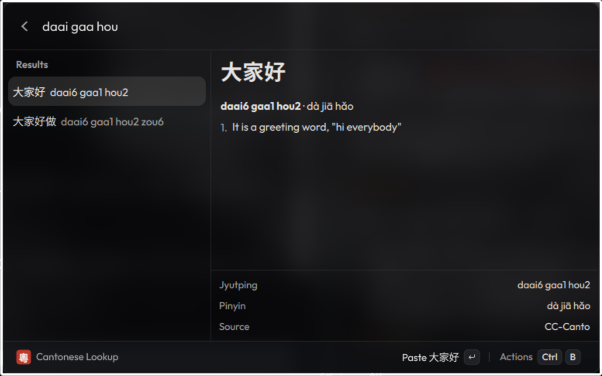

# Cantonese Lookup for Vicinae

Search Cantonese characters, words and phrases by jyutping or English definition, offline.



- Jyutping: `nei5 hou2`, `neihou`, `nei ho` (tones, spaces and the end of the last syllable are optional)
- English: `hello`, `to eat`, `thank you`
- Characters (traditional or simplified): `電腦`, `电脑`

The detail pane shows the full definitions, plus Mandarin pinyin for reference (pinyin isn't searched).

Enter pastes; the other actions are in the action panel (Ctrl+B): copy, paste the other
script (Shift+Enter), copy jyutping (Ctrl+J), copy full entry (Ctrl+Shift+C), toggle definitions
(Ctrl+D), forget usage (Ctrl+X).

## Ranking

Within a match tier (exact > prefix > contained), results are ordered by:

1. Base usage: HKCanCor (spoken Cantonese, with per-reading counts) and wordfreq's Chinese list
2. Source: CC-Canto above CC-CEDICT; variant/surname-only entries and guessed readings are demoted
3. Length: long phrases are slightly demoted
4. Your usage: every paste/copy is recorded per entry and per query (Vicinae local storage), so things
   you pick keep moving up for the queries you used

## Building

```sh
npm install
npm run build          # installs into ~/.local/share/vicinae/extensions/cantonese
npm test               # ranking tests against assets/dict.json
```

`assets/dict.json` is generated. To regenerate it (e.g. for a newer CC-CEDICT):

```sh
scripts/fetch_data.sh data
python -m venv .venv && .venv/bin/pip install -r requirements.txt
npm run dict
```

## Data

- [CC-Canto](https://cantonese.org) and the CC-CEDICT Cantonese readings, © Pleco Inc., CC BY-SA 3.0
- [CC-CEDICT](https://cc-cedict.org), MDBG, CC BY-SA 4.0
- Frequencies: HKCanCor via [PyCantonese](https://pycantonese.org), [wordfreq](https://github.com/rspeer/wordfreq)
